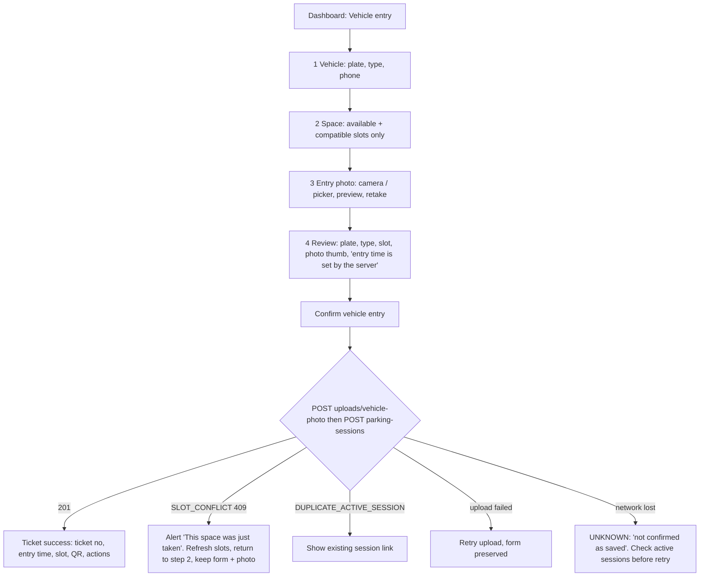
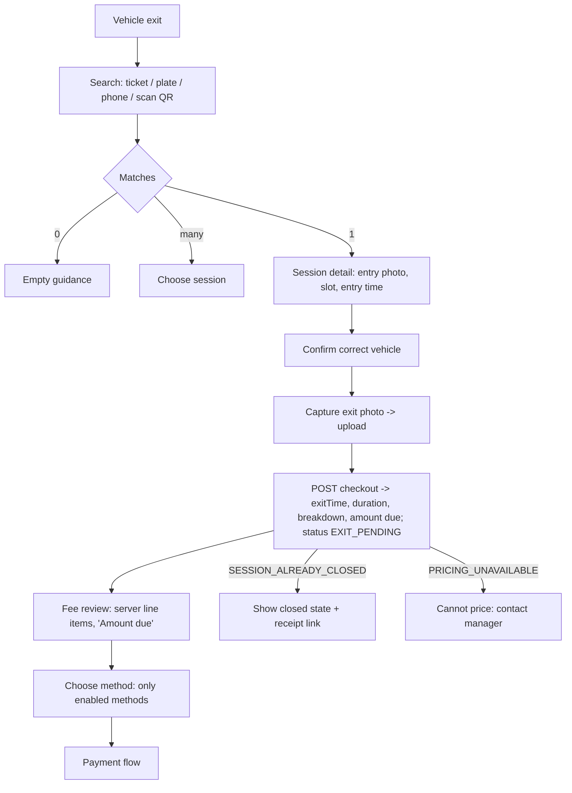
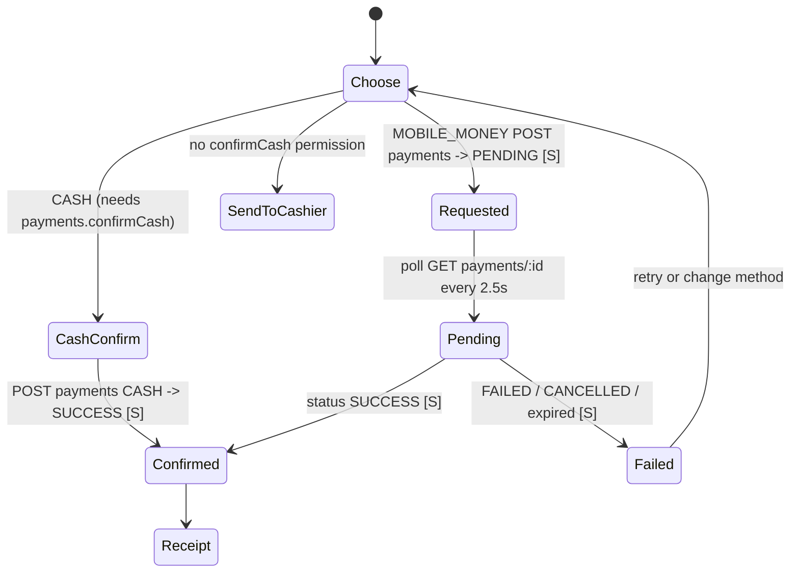

# USER_FLOWS

Notation: **[S]** = server-confirmed state, **[D]** = local draft (not official). Mermaid diagrams render on GitHub/VS Code.

## 1. Authentication and session

```mermaid
flowchart TD
  A[Open app] --> B{Access token in memory?}
  B -- no --> C[POST /auth/refresh via cookie]
  C -- ok --> D[GET /me]
  C -- 401 --> L[/login]
  B -- yes --> D
  D --> E[RoleHome redirect by role]
  L --> M{Social enabled? GET /auth/providers}
  M -- yes --> N[Social buttons first]
  M -- no --> O[Disabled with explanation]
  L --> P[Identifier + password]
  P --> Q{Result}
  Q -- 200 --> D
  Q -- INVALID_CREDENTIALS --> R[Inline error, keep identifier]
  Q -- ACCOUNT_DISABLED --> S[Disabled screen, contact manager]
  Q -- RATE_LIMITED --> T[Locked message + retry-after countdown]
  Q -- network --> U[Connection lost message + retry]
  E --> V[Any 401 later -> SESSION_EXPIRED -> /login?reason=expired]
```

## 2. Vehicle entry (attendant, one hand, 5 steps)


Double submit is prevented by `useGuardedMutation` plus a disabled button and a per-attempt `Idempotency-Key`.

## 3. Photo capture

States: idle -> requesting permission -> live viewfinder -> captured (device only) -> compressing -> uploading n% -> uploaded [S]. Errors: permission denied (offer picker), camera unavailable (offer picker), file too large, network failure (retry upload, keeps preview). "Captured on this device" and "Uploaded" are different badges.

## 4. Active sessions and lookup

Active list (cards on mobile, table on desktop): ticket, plate, type, slot, entry time, live elapsed, attendant, status. Search: ticket / plate / phone / slot / QR via `GET /parking-sessions/search`. Zero results -> "No active parking session found. Check the ticket or plate number and try again." Multiple matches -> chooser list.

## 5. Vehicle exit and checkout


Frontend never computes duration or amount. Fee review shows `breakdown[]` lines returned by the server.

## 6. Payment


UI wording: button "Request payment" -> state "Request sent" -> "Waiting for payment confirmation. Do not request another payment yet." -> "Payment confirmed. Receipt is ready." Failure: "Payment was not confirmed. You can check the status or try another available method." While PENDING the "Request payment" control is disabled (duplicate attempt warning). No animation implies success before `SUCCESS` arrives; the success panel is static + a single short check mark after server confirmation.

## 7. Receipt

Payment SUCCESS -> session COMPLETED [S] -> `GET /parking-sessions/:id/receipt` -> Receipt page (view, print, PDF, share if supported, reprint with `receipts.reprint`). Slot release is shown as "Space A-023 is now available" only if the refreshed slot is AVAILABLE.

## 8. Parking history and search

Filters (URL-synced): date range, ticket, plate, phone, slot, attendant, payment status, session status, vehicle type. Server pagination + sort. Detail drawer/page: photos, timeline, payment attempts, receipt, audit events (if `audit.view`).

## 9. Owner monitoring

Dashboard (lot + date range filters, visible chips) -> KPI cards (confirmed vs pending separated) -> charts -> recent activity -> alerts -> drill into sessions/payments/reports. Revenue "Confirmed" excludes PENDING/FAILED; pending is its own card.

## 10. Reports and audit

Reports: period tabs (day/week/month) + filters -> summary totals, revenue by method, occupancy, attendant activity, session stats, export CSV (client-side from the returned rows) and print/PDF. Audit: filters (date, actor, action, entity) -> table -> detail with before/after metadata when authorised.

## 11. Staff and configuration

Staff: list -> add (name, phone/email, role, lots) -> detail (status toggle with confirm + reason, lot assignment, activity). Settings: organization, locations, slots, pricing, payment methods (read-only status, no secrets), notification preferences, profile, help, sign out.

## 12. Recovery matrix

| Situation | UI behaviour |
|---|---|
| Slot taken during entry | 409 -> alert, refresh slots, step 2, form kept |
| Camera denied | Explain how to allow in browser settings + file picker button |
| Upload fails | Preview kept, "Retry upload", progress reset |
| Network drops mid-submit | "Connection lost. This action has not been confirmed as saved." + Check status |
| Token expires | `/login?reason=expired` with notice; after login `next` restores path (drafts restored) |
| Session already closed | Info state with link to receipt |
| Pending payment, user leaves | Cashier queue + session detail show PENDING; polling resumes on return |
| Offline | Banner; entry/exit/payment actions disabled with reason |
